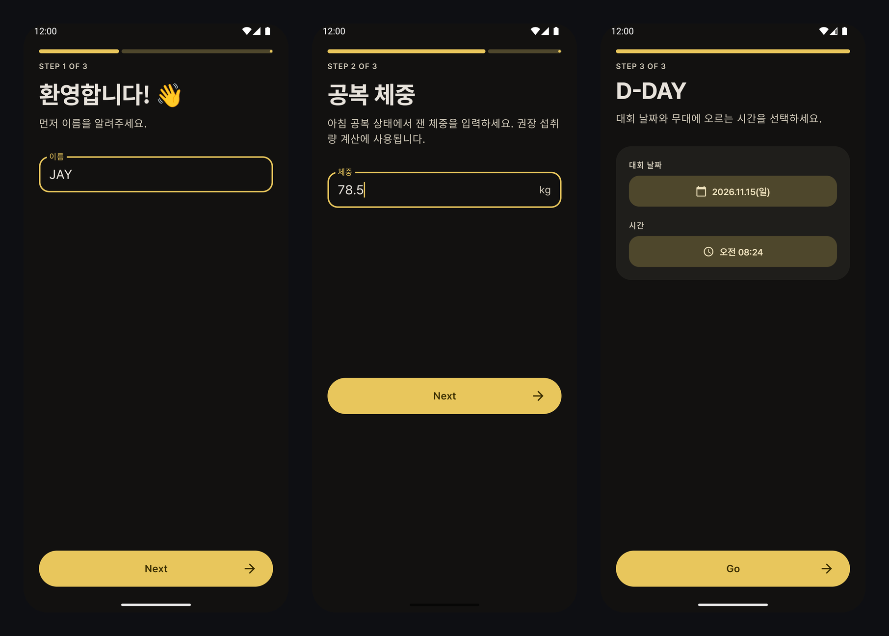
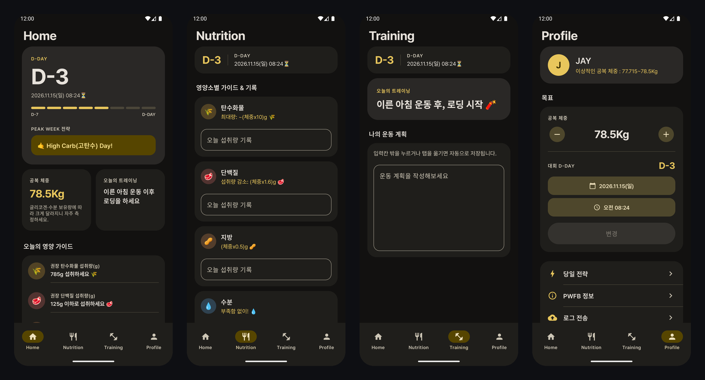

# PWFB (Peak Week For Bodybuilder)

보디빌딩 대회 D-Day를 기준으로 피크위크(대회 전 7일) 동안의 영양 섭취량과 트레이닝 전략을 안내하는 Android 앱입니다.

[Google Play에서 설치하기](https://play.google.com/store/apps/details?id=com.pwfb&hl=ko)

## 화면

온보딩(이름 → 공복 체중 → 대회 D-Day)

메인 탭(홈 · 영양 · 트레이닝 · 프로필)

## 기능

| 탭 | 내용 |
|---|---|
| 홈 | D-Day 히어로 카드(대회 일시, D-7 → D-DAY 진행 스트립, 오늘의 피크위크 전략), 공복 체중·오늘의 트레이닝 요약, 영양소별 권장 섭취량 |
| 영양 | 영양소별 카드에 일자별 가이드와 오늘 섭취량 기록 (탄수화물·단백질·지방·수분·나트륨·칼륨·크레아틴·식이섬유) |
| 트레이닝 | 오늘의 트레이닝 안내와 운동 계획 기록 |
| 프로필 | 이름·이상적인 공복 체중 범위, 공복 체중(±0.1kg)과 대회 날짜·시간 수정, 당일 전략, PWFB 정보, 오류 로그 전송 |

첫 실행 시 이름 → 체중 → 대회 날짜 순으로 입력받고(온보딩), 이후에는 메인 화면으로 바로 진입합니다.

## 동작 규칙

- **D-Day**는 달력 날짜 기준으로 계산합니다. 대회 3일 전이면 시각과 관계없이 `D-3`입니다.
- 영양·트레이닝 전략은 `D-7 ~ D-1` 구간에서 날짜별로 바뀌고, 그 외 기간은 평소 섭취를 안내합니다.
- Play 스토어에서 설치된 앱은 시작 시 **즉시 업데이트**를 요구하며, 사용자가 업데이트를 취소하면 앱이 종료됩니다. 로컬 빌드는 이 검사를 건너뜁니다.
- UI는 Material 3 다크 테마로 고정이며(시스템 라이트/다크 설정과 무관), 서체는 Pretendard Std를 번들합니다(`licenses/Pretendard-OFL.txt`).
- 온보딩에서 뒤로 가기는 이전 단계로 돌아가고, D-Day까지 저장하면 온보딩 화면은 백스택에서 제거됩니다.
- 영양 섭취량과 운동 계획은 입력칸에서 포커스가 빠질 때(입력칸 밖 터치, 탭 이동, 완료 키) 자동 저장됩니다.

## 기술 구성

- Kotlin, 단일 모듈(`app`)
- UI 전체가 Jetpack Compose + Material 3 (XML 레이아웃 없음). 화면은 `ui/screen/*Screen.kt`, 테마는 `theme/`, ViewModel은 `ui/viewmodel/`
- 단일 `MainActivity`가 `PwfbNavHost`로 온보딩(이름 → 체중 → D-Day)과 메인(탭 4개)을 모두 그린다
- Hilt(KSP) 의존성 주입, Preferences DataStore 저장
- 구조: `ui`(Compose 화면/ViewModel) → `domain`(UseCase/Repository 인터페이스/Entity) → `data`(Repository 구현, Hilt 모듈)
- Firebase: Analytics, Crashlytics, Storage(오류 로그 업로드)
- AdMob 배너, Play In-App Update
- 날짜·시간 선택은 Compose Material 3 `DatePickerDialog` / `TimePicker`

버전은 `gradle/libs.versions.toml`에서 관리합니다. AGP 9 내장 Kotlin을 사용하므로 `org.jetbrains.kotlin.android` 플러그인은 모듈에 적용하지 않고 루트에 버전만 선언합니다.

## CI

`.github/workflows/android-ci.yml`

- 기본 브랜치로 향하는 PR: lint + 단위 테스트 (서명 키 등 릴리즈 시크릿은 사용하지 않음)
- `compose+clean_architecture`(기본 브랜치) push: 추가로 디버그·릴리즈 APK를 빌드해 7일간 artifact로 보관

필요한 Repository Secret: `GOOGLE_SERVICES_JSON`, `STORE_FILE`(base64), `KEY_ALIAS`, `KEY_PASSWORD`, `STORE_PASSWORD`, `ADMOB_API_KEY`

## 저장 데이터

- 사용자 설정은 Preferences DataStore(`pref_pwfb`)에 저장되며 Android 자동 백업에 포함됩니다.
- 저장 실패 등 오류 로그는 `files/logs/<날짜>.txt`에 기록되고 7일이 지나면 삭제됩니다. 백업에는 포함되지 않습니다.
- 프로필의 "로그 전송"은 오늘 로그를 Firebase Storage `logs/<날짜>/<앱 설치 ID>.txt`로 업로드합니다.
